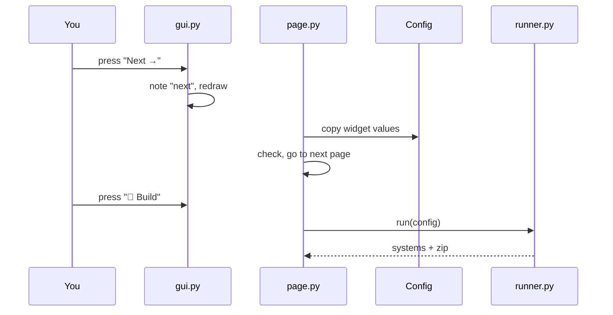

# Code reference

This part of the documentation is generated from the explanations written in the code itself
(the *docstrings*). It is meant for anyone who wants to understand how OpenMembraneBuilder
works inside, change it or build on it.

## How the code is organised

```text
openmembranebuilder/
├── cli.py                  the omb command (omb gui / omb cli)
├── app.py                  the page Streamlit opens
├── wizard/                 the step-by-step workflow
│   ├── state.py            what the wizard remembers
│   ├── navigation.py       next / back
│   ├── page.py             welcome page, hand-over between builders, config.json
│   ├── gui.py              results page
│   ├── run_simulations.py  the "Run simulations" button (hidden by --no-run)
│   └── runner.py           rebuilding from config.json (omb cli)
├── builders/
│   ├── martinize/          preparing proteins
│   │   ├── config.py       settings  ─┐
│   │   ├── gui.py          widgets    │ the same four parts
│   │   ├── page.py         clicks     │ in every builder
│   │   └── runner.py       the work  ─┘
│   └── membrane/           building the systems
│       ├── config.py, gui.py, page.py, runner.py
│       ├── parser.py       force fields, lipids, templates, COBY membrane text
│       └── schematic.py    the system view picture
├── core/
│   ├── global_info.py      folder locations
│   ├── filemanager.py      copying files, zip archive
│   └── gui.py              common page layout
└── resources/              force fields, mdp files, scripts, templates
```

## How a click becomes a build

Streamlit redraws the whole page after every click. The pages therefore follow one pattern:

1. **`gui.py`** draws the widgets. A button only leaves a short note in the session memory
   (for example `_membrane_action = "next"`) and asks for a redraw.
2. **`page.py`** reads the note on the redraw, copies the widget values into the builder's
   **`config.py`** object, checks them and moves to the next page.
3. **`runner.py`** does the actual work from the config object alone – which is why
   `omb cli` can run the same code from a `config.json` without any page.



## Pages in this section

- [omb command](cli.md) – `cli`, `app`
- [Wizard](wizard.md) – `wizard.*`
- [Protein preparation](martinize.md) – `builders.martinize.*`
- [Membrane builder](membrane.md) – `builders.membrane.*`
- [Core helpers](core.md) – `core.*`
