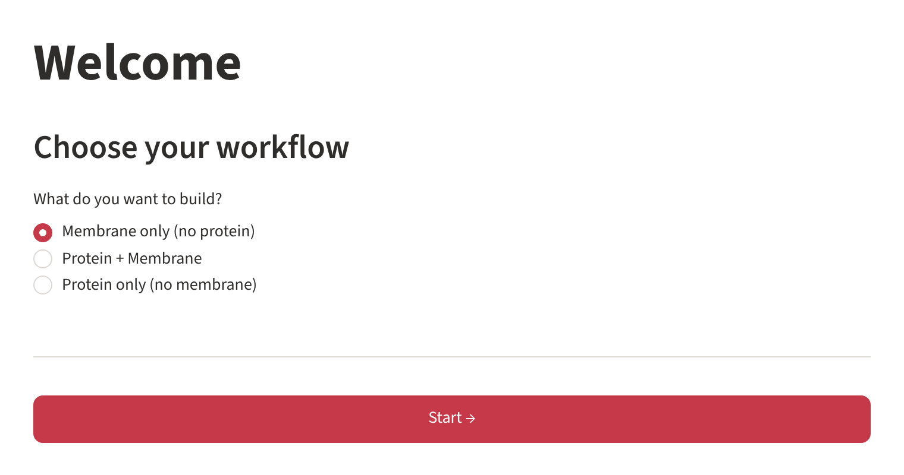
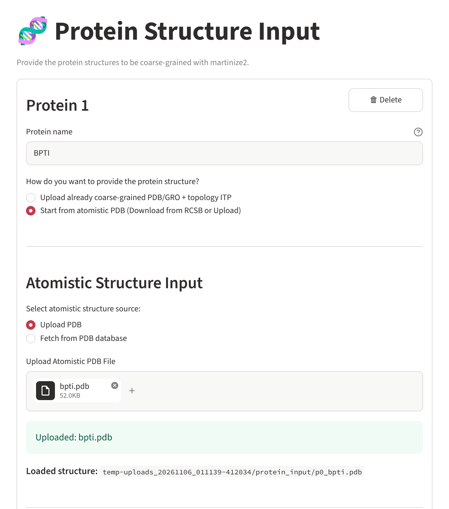
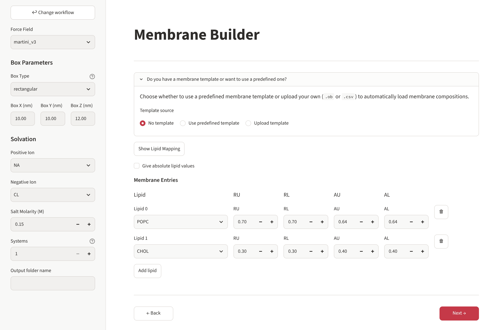
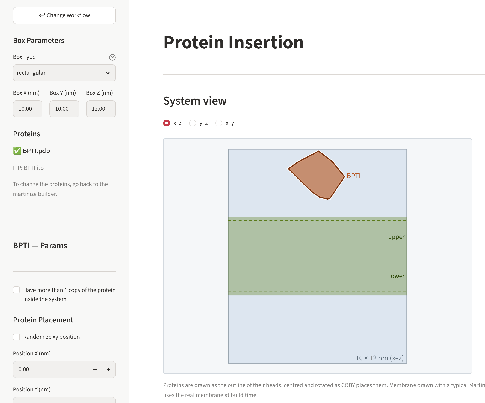
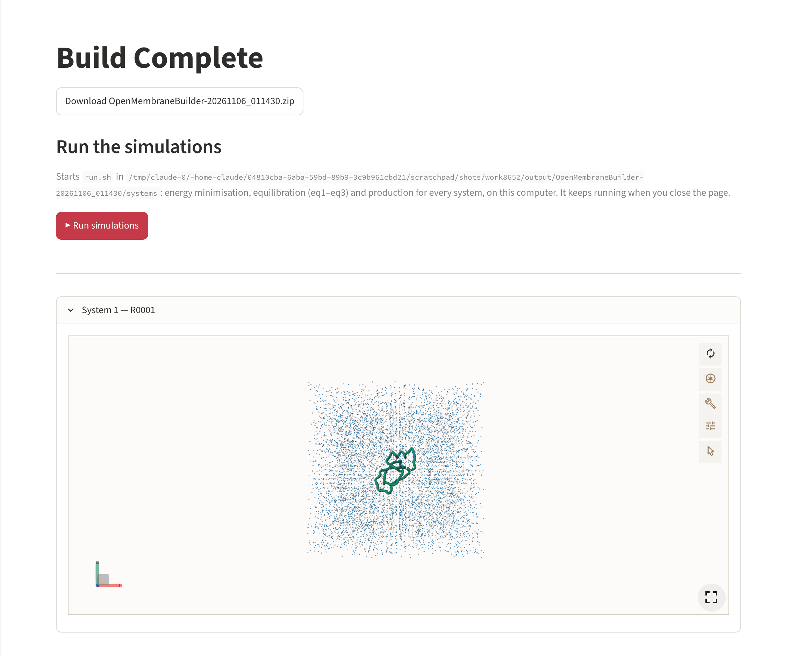

# Your first system

This walk-through builds a 15 × 15 nm POPC/cholesterol bilayer (70 : 30) with one ubiquitin
(PDB 1UBQ) on top of it, in 150 mM NaCl, and runs the first GROMACS steps.

!!! info "About the screenshots"
    The pictures on this page were taken while building BPTI (named `BPTI`, uploaded as an
    atomistic file) in a 10 × 10 × 12 nm box. The steps are exactly the same.

## 1. Start the app

```bash
mkdir my_builds && cd my_builds
omb gui
```

Your browser opens the welcome page (if not, open the address printed in the terminal,
usually <http://localhost:8501>).

{ .screenshot }

Choose **Protein + Membrane** and press **Start →**.

## 2. Prepare the protein

1. **Protein name**: `1UBQ`. The files become `1UBQ.pdb` and `1UBQ.itp`, and the topology will
   list the protein as `1UBQ`.
2. **How do you want to provide the protein structure?** – *Start from atomistic PDB*.
3. **Fetch from PDB database**, type `1UBQ`, press **Fetch Structure**.
4. Keep **Clean structure** ticked (removes the crystal water) and press **Next →**.

{ .screenshot }

On the next page keep chain **A**, the force field **martini3001**, **MDTraj DSSP** for the
secondary structure and the elastic network, and press **🧬 Run Martinize Preprocessor**.
After a few seconds the coarse-grained files are listed; press **Next: Membrane Builder ➡️**.

!!! tip "Already have coarse-grained files?"
    Choose *Upload already coarse-grained PDB/GRO + topology ITP* instead, upload both files
    and say which Martini version they are for. See [Preparing proteins](../user-guide/proteins.md).

## 3. Compose the membrane

In the sidebar:

- **Force Field**: `martini_v3`
- **Box**: rectangular, X = 15, Y = 15, Z = 15 nm
- **Solvation**: NA / CL, 0.15 M
- **Systems**: 1

In the main area, fill the lipid table:

| Lipid | RU | RL | AU | AL |
|---|---|---|---|---|
| POPC | 0.70 | 0.70 | 0.64 | 0.64 |
| CHOL | 0.30 | 0.30 | 0.40 | 0.40 |

RU/RL are the fractions in the upper and lower leaflet (each column adds up to 1), AU/AL the
area per lipid in nm². Press **Next →**.

{ .screenshot }

## 4. Place the protein

- **Z placement method**: *Height above Membrane*, **Distance above membrane**: 1.5 nm.
- Leave position (0, 0) and rotation (0, 0, 0).

The **system view** shows box, membrane and protein exactly as COBY will place them; switch
between the x–z, y–z and x–y views. Press **Next →**.

{ .screenshot }

## 5. Check and build

The preview lists every setting. Press **🔨 Build**. After a minute or two the results page
offers the zip archive and shows the system in 3D.

{ .screenshot }

## 6. Look at the result

```text
my_builds/
├── output/OpenMembraneBuilder-<date>_<time>/
│   ├── config.json
│   ├── systems/R0001/system.gro, system.pdb, topol.top
│   ├── systems/run.sh
│   ├── toppar/  mdp/  scripts/  user_inputs/
└── downloads/OpenMembraneBuilder-<date>_<time>.zip
```

## 7. Run GROMACS

Press **▶ Run simulations** on the results page – or, from a terminal:

```bash
cd output/OpenMembraneBuilder-<date>_<time>/systems
./run.sh
```

For every system `run.sh` minimises the energy, creates the index groups, equilibrates in
three steps and starts the production run. See [Output and GROMACS](../reference/outputs.md).

## 8. Build it again – without the browser

```bash
omb cli output/OpenMembraneBuilder-<date>_<time>/config.json
```

builds the same system into a new folder `output/OpenMembraneBuilder-<date>_<time>-headless/`.
Change `n_systems` in the file to `5` first, and you get five replicas. See
[Command line](../user-guide/cli.md).
