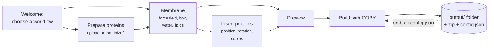

---
hide:
  - navigation
  - toc
---

<div class="omb-hero" markdown>

# OpenMembraneBuilder

Build Martini coarse-grained membranes and membrane–protein systems – in the browser or from
the command line – ready to simulate with GROMACS. Choose the lipids of every leaflet, prepare
and place your proteins, and get structure, topology, force field, simulation settings and a
run script for every system.

[Get started](getting-started/installation.md){ .md-button .md-button--primary }
[Your first system](getting-started/quickstart.md){ .md-button }
[config.json reference](reference/config.md){ .md-button }

</div>

The systems are built by [COBY](https://github.com/MikkelDA/COBY); proteins are
coarse-grained with [martinize2](https://github.com/marrink-lab/vermouth-martinize).

```bash
pip install openmembranebuilder-2.0.0.tar.gz
omb gui                  # build in the browser
omb cli config.json      # rebuild the same systems without the browser
```

<div class="grid cards" markdown>

-   :material-download-outline:{ .lg .middle } **Install**

    ---

    One `pip install`, all dependencies included.

    [:octicons-arrow-right-24: Installation](getting-started/installation.md)

-   :material-rocket-launch:{ .lg .middle } **Your first system**

    ---

    A POPC/cholesterol bilayer with ubiquitin in ten minutes.

    [:octicons-arrow-right-24: Quick start](getting-started/quickstart.md)

-   :material-book-open-variant:{ .lg .middle } **User guide**

    ---

    Every page of the app and every option, explained.

    [:octicons-arrow-right-24: The workflow](user-guide/workflow.md)

-   :material-code-json:{ .lg .middle } **Reference**

    ---

    `config.json`, output folders, force fields and simulation settings.

    [:octicons-arrow-right-24: config.json](reference/config.md)

-   :material-crosshairs-gps:{ .lg .middle } **Place your proteins**

    ---

    Position, height, rotation and copies, checked in a live system view before building.

    [:octicons-arrow-right-24: Inserting proteins](user-guide/protein-insertion.md)

-   :material-play-circle-outline:{ .lg .middle } **Simulate**

    ---

    Minimisation, equilibration and production with GROMACS – from the app or with `run.sh`.

    [:octicons-arrow-right-24: Output and GROMACS](reference/outputs.md)

</div>

## What it does

- **Membranes** – any mixture of the lipids shipped with Martini 3 or Martini 2.2, different
  in the two leaflets, given as fractions or as exact numbers of lipids, typed in or loaded
  from a [template](user-guide/templates.md).
- **Proteins** – upload coarse-grained files, or start from an atomistic structure (your own
  file or a PDB code) that is cleaned, cut to the chains and residues you want, optionally
  mutated, and converted with martinize2. Each protein gets a name of your choice.
- **Placement** – put every protein where you want it: position, height (absolute, or a gap
  above the membrane), rotation, random placements, several copies moving together or each on
  its own – and see the result in a [schematic system view](user-guide/protein-insertion.md#the-system-view)
  before building.
- **Replicas** – build up to 99 independent systems at once, with the same or with
  different random protein placements.
- **Ready for GROMACS** – each build contains the force field, the topology with clean
  includes, the minimisation/equilibration/production settings and a `run.sh` that runs them
  for every system.
- **Reproducible** – every build writes a `config.json`; `omb cli config.json` builds the same
  systems again, on your laptop or on a cluster.

## How it works



## What you get

```text
output/OpenMembraneBuilder-20261106_101500/
├── config.json        every setting of this build
├── user_inputs/       copies of your input files (1UBQ.pdb, 1UBQ.itp, templates)
├── toppar/            force field and protein topologies
├── mdp/               em, eq1, eq2, eq3, md
├── scripts/           index.sh
└── systems/
    ├── run.sh         runs every system: minimisation → equilibration → production
    ├── R0001/         system.gro, system.pdb, topol.top
    └── R0002/ …
downloads/OpenMembraneBuilder-20261106_101500.zip
```

See [Output and GROMACS](reference/outputs.md) for every file.

## Citing

If OpenMembraneBuilder helps your research, please [cite it](citation.md) together with COBY
and martinize2.
