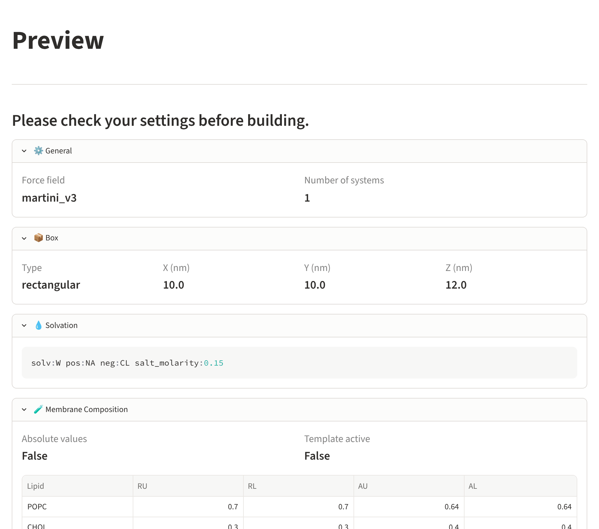
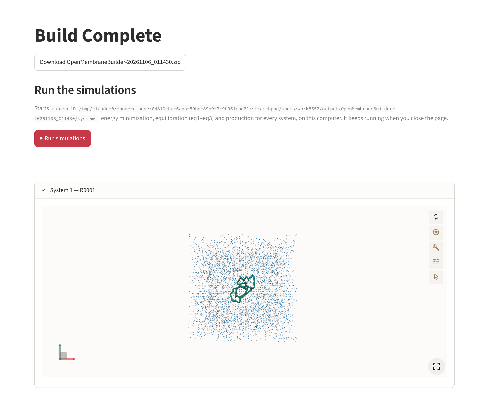

# Preview, build and results

## Preview

{ .screenshot }

Before anything is built, the preview lists every setting:

- **General** – force field, number of systems, output name;
- **Box** – type and lengths;
- **Solvation** – the solvation text passed to COBY;
- **Membrane composition** – the lipid table (fractions or numbers);
- **Protein insertion** – for every protein its files, copies, position, height and rotation
  (or *Randomized*).

**← Back** returns to the previous page to change something; **🔨 Build** starts the build.

!!! warning "Martini 2 / Martini 3 mismatch"
    When the proteins were prepared for another Martini generation than the membrane force
    field (or for different generations among themselves), the preview shows a warning, and
    **Build** stays disabled until you tick *I understand the risk and want to build anyway*.
    Mixing the two generations usually makes the simulation fail or gives wrong results.

## Build

For every composition and every system the builder

1. works out where each protein goes (fixed, random, grid or independent copies),
2. lets COBY build the membrane, insert the proteins, add water and ions, and write
   `system.gro` and `topol.top`,
3. makes the topology tidy (include paths into `toppar/`, a descriptive title, one line per
   protein),
4. writes `system.pdb` for viewing.

Afterwards the whole output folder is packed into `downloads/<folder>.zip`, and `config.json`
with all settings is written next to the systems and added to the zip.

Building takes from under a minute (a small bilayer) to several minutes (large boxes, many
systems, *Height above Membrane*, which builds the membrane twice per system).

## Results

{ .screenshot }

- **Download OpenMembraneBuilder-….zip** – the complete build.
- **▶ Run simulations** – starts the simulations on this computer (see below).
- A 3D view (Mol\*) of the first two systems. A protein that crosses the box edge is shown in
  one piece; the files themselves are not changed.

The same files are in `output/` in the folder where you started `omb gui`. To start again,
press **↩ Change workflow** in the sidebar.

## Run the simulations

Right after a build, the results page offers **▶ Run simulations**. It starts `run.sh` in the
build's `systems/` folder, which for every system runs the energy minimisation, creates the
index groups, equilibrates (eq1–eq3) and starts the production run – the same as running
`./run.sh` yourself (see [Output and GROMACS](../reference/outputs.md#running)).

- The simulations run **in the background on the computer where `omb gui` runs**. You can
  close the page; they continue.
- While they run, the page shows **⏳ The simulations are running**, the latest lines of
  `systems/run.log`, **🔄 Refresh** and **⏹ Stop** (stops `run.sh` and the GROMACS programs it
  started).
- The button only appears after a finished build, and it is greyed out with an explanation
  when `gmx` or `jq` cannot be found – start `omb gui` from an environment where both work
  (e.g. after `source /path/to/gromacs/bin/GMXRC`).

| File in `systems/` | Content |
|---|---|
| `run.log` | everything `run.sh` and GROMACS print |
| `run.pid` | the process number, so the page can find and stop the run |

!!! warning "On a shared or public server: `omb gui --no-run`"
    The Run button starts programs on the machine that serves the app. When the app is
    offered to other people – on a web server, a group server, a course machine – start it
    with

    ```bash
    omb gui --no-run
    ```

    The button is then not shown at all; users build and download, but cannot run anything
    on the server. The same is achieved with the environment variable `OMB_NO_RUN=1`, e.g.
    for `streamlit run app.py` or a service file:

    ```bash
    OMB_NO_RUN=1 streamlit run app.py --server.port 8501
    ```

## Next steps

- Run the simulations: [Output and GROMACS](../reference/outputs.md).
- Build more replicas or variations without the browser: [Command line](cli.md).
