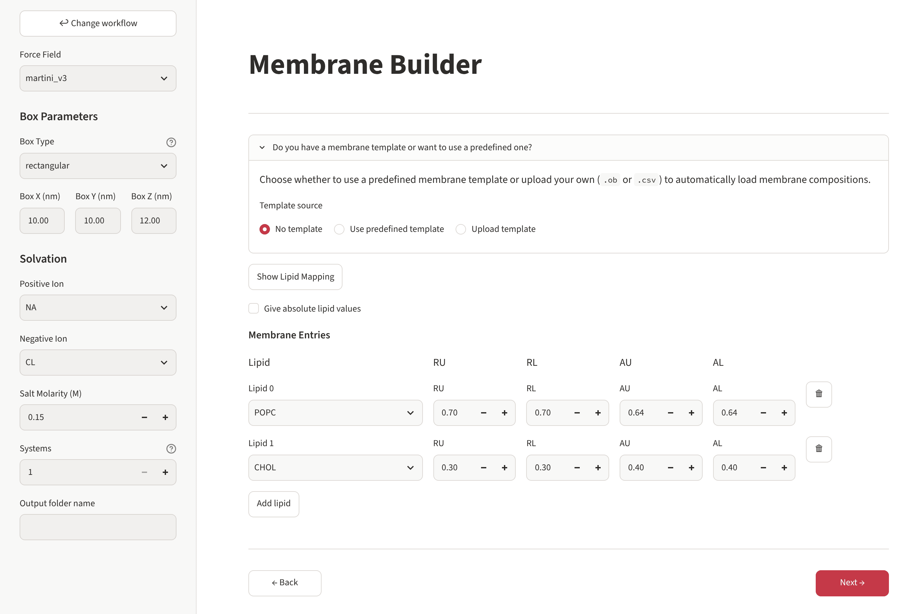

# Building the membrane

The membrane page sets everything that is the same for all systems of a build: force field,
box, water and ions, how many systems, and the lipid composition.

{ .screenshot }

## Sidebar

### Force field

| Choice | Use with |
|---|---|
| `martini_v3` (default) | Martini 3 proteins (`martini3001`, `martini3001-idp`) |
| `martini_v2.2` | Martini 2.2 proteins (`martini22`) |

The lipid list follows the force field. When the proteins were prepared for the other Martini
generation, a warning appears (see [Preparing proteins](proteins.md)).

### Box

| Box type | Lengths you give | Shape |
|---|---|---|
| `rectangular` | X, Y, Z | a rectangular box |
| `hexagonal` | X, Z | a hexagonal prism (Y follows from X) |
| `skewed_hexagonal` | X | a skewed hexagonal box (all lengths follow from X) |

Lengths are in nm, between 5 and 50. The box can also be changed later on the
[protein insertion page](protein-insertion.md), where you see whether the proteins fit.

!!! tip "How large?"
    Leave at least 2–3 nm of lipids between a protein and its periodic image, and enough water
    above the membrane for proteins that sit on it. Z sets the total height: the membrane
    (≈ 4–5 nm) plus the water layers on both sides.

### Solvation

- **Positive ion**: `NA` or `CA`.
- **Negative ion**: `CL`, `BR`, `IOD`, `ACE`, `BF4`, `PF6`, `SCN`, `CLO4` or `NO3`.
- **Salt molarity** (M): the salt concentration. COBY adds the ions for it and, by default,
  neutralises the charge of the system.
- **Percentage of unfreezable water** (Martini 2.2 only): part of the water is replaced by
  antifreeze water (WF), which prevents freezing of Martini 2 water.

The result is a COBY solvation text, for example `solv:W pos:NA neg:CL salt_molarity:0.15`.

### Systems

How many independent systems (replicas) to build, 1–99. They have the same composition;
proteins can be placed the same way in all of them or at new random positions/orientations
in each (see [Inserting proteins](protein-insertion.md#several-systems)).

### Output folder name

Optional. It is added to the output folder:
`output/OpenMembraneBuilder-<date>_<time>-<name>/`.

## Lipid composition

### Template or by hand

The box **Do you have a membrane template or want to use a predefined one?** offers:

- **No template** – type the composition in the table below.
- **Use predefined template** – choose one of the templates shipped with the program.
- **Upload template** – your own `.csv` / `.ob` file (an example can be downloaded there).

A template fills the table; you can still edit the rows. Your hand-typed rows are kept aside
and come back when you switch to *No template*. The format is explained in
[Membrane templates](templates.md).

### Lipid mapping

**Show Lipid Mapping** opens a searchable table of all lipids of the force field with their
type, head group, linker and tails (with bead types), filterable by each column and
downloadable as CSV. Use it to find the residue name of the lipid you want.

### The table

Each row is one lipid:

| Column | Meaning |
|---|---|
| **Lipid** | residue name, e.g. `POPC`, `CHOL`, `POPS`, `PIP2` … |
| **RU** / **RL** | fraction of this lipid in the **u**pper / **l**ower leaflet |
| **NU** / **NL** | with *Give absolute lipid values*: **n**umber of lipids in the upper / lower leaflet |
| **AU** / **AL** | area per lipid in the upper / lower leaflet, nm² (default 0.6) |

**Add lipid** adds a row, 🗑 removes one.

=== "Fractions (default)"

    The values of each leaflet must add up to **1.0**. COBY fills the box area with lipids in
    these proportions; the number of lipids follows from the box size and the areas per lipid.

    | Lipid | RU | RL | AU | AL |
    |---|---|---|---|---|
    | POPC | 0.6 | 0.4 | 0.64 | 0.64 |
    | POPS | 0.0 | 0.2 | 0.65 | 0.65 |
    | CHOL | 0.4 | 0.4 | 0.40 | 0.40 |

    → an asymmetric membrane with POPS only in the lower leaflet.

=== "Numbers of lipids"

    Tick **Give absolute lipid values**. The values are exact numbers of lipids per leaflet
    (whole numbers); the area per lipid still sets how much space each takes.

    | Lipid | NU | NL | AU | AL |
    |---|---|---|---|---|
    | POPC | 120 | 100 | 0.64 | 0.64 |
    | PIP2 | 0 | 20 | 0.70 | 0.70 |

!!! info "Upper and lower"
    *Upper* is the leaflet at higher z (towards the top of the box), *lower* the one below.
    Proteins placed "above the membrane" sit on the upper leaflet.

A lipid with 0 in a leaflet is simply left out of that leaflet.

### Checks on Next

- At least one lipid.
- Fractions: each leaflet adds up to 1.0.
- Numbers: each leaflet adds up to a whole number.

Problems are listed at the top of the page and you stay on it until they are fixed.

## Protein only (no membrane)

In the *Protein only* workflow this page shows only the sidebar (force field, box, water and
ions, systems, name): the proteins are solvated without a membrane.
