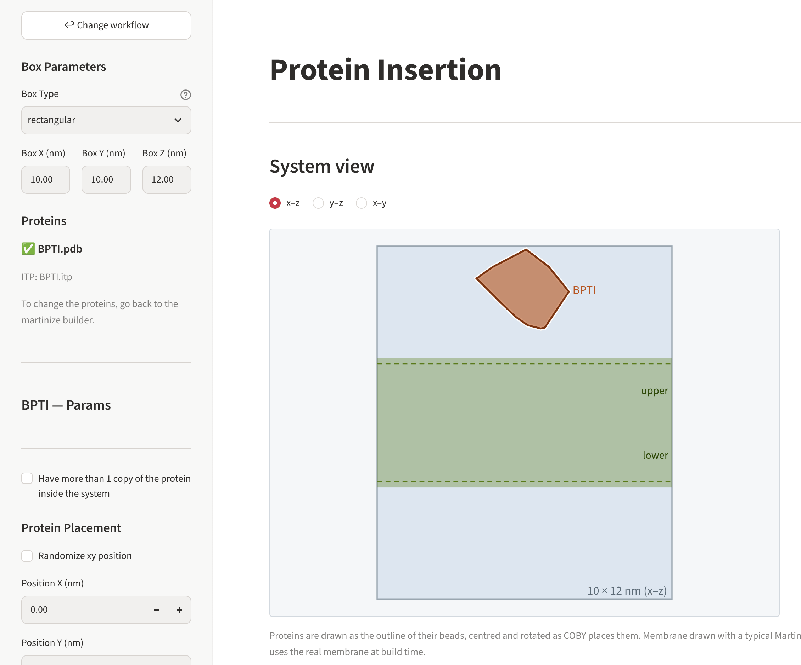
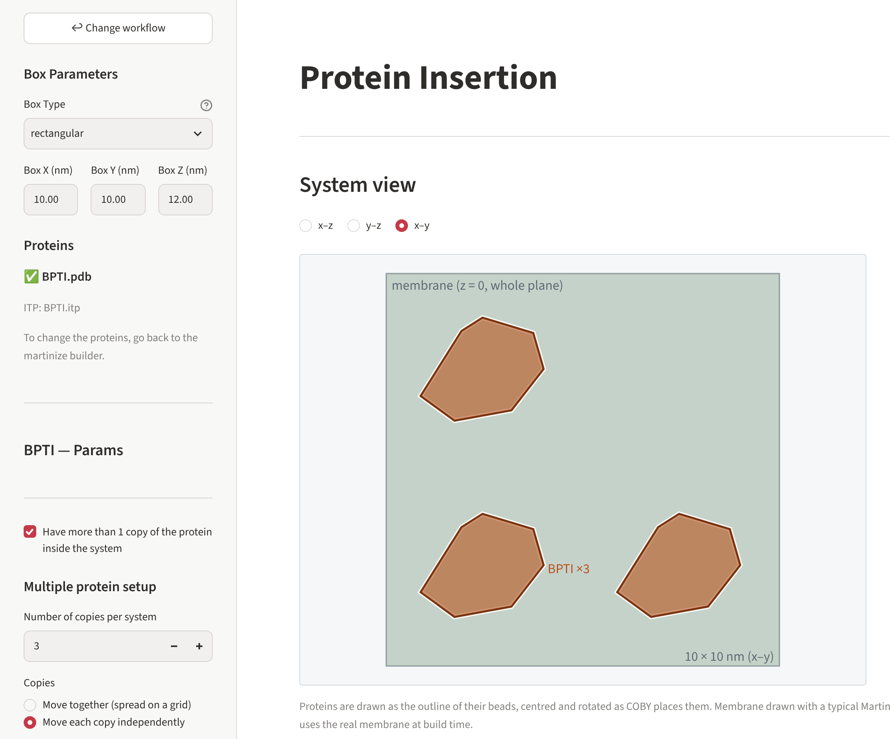

# Inserting proteins

This page decides where each protein goes and how it is turned. The sidebar holds the box and
the settings of every protein; the main area shows the **system view**, a schematic picture of
the box, the membrane and the proteins exactly as COBY will place them.

{ .screenshot }

## Coordinates

All positions are in **nm, measured from the centre of the box**: x and y run from −X/2 to
+X/2 and −Y/2 to +Y/2; z = 0 is the middle of the box, which is where the membrane is built.
Positive z is above the membrane (the upper leaflet side).

Each protein is placed by its **centre** – the middle of all its beads (centre of geometry).

## The box

The box settings of the membrane page are repeated at the top of the sidebar, so you can make
the box larger or smaller while you look at the proteins. Positions are always kept inside
the box.

## Position (x, y)

- **Position X / Y** – where the protein's centre goes.
- **Randomize xy position** – a random position, at least 2.5 nm from the box edge.
  With several systems, **Re-randomize position for each system** draws a new one for every
  system; otherwise all systems share one random position.

### Two proteins: by their distance

With exactly two proteins you can tick **Set distance between proteins instead of X/Y
positions** and give the **Distance between proteins** (nm). The two are then placed on the
x axis, the first at +x and the second at −x, so that the gap between their facing edges is
that distance – taking their size after rotation into account.

## Height (z)

| Z placement method | You give | The protein's centre goes to |
|---|---|---|
| **Absolute z position** | **Absolute Z** (nm from the box centre) | exactly that z |
| **Height above Membrane** | **Distance above membrane** (nm) | the height at which its **lowest bead** is that distance above the membrane surface |

With *Height above Membrane* the builder first builds the membrane alone, measures its upper
surface (the average height of the highest 10 % of the lipid beads) and then lifts the
protein so its lowest bead – after rotation – sits the chosen distance above it. Use a small or
zero distance for a protein resting on the membrane, a larger one to start it in the water.

!!! tip "Transmembrane proteins"
    For a protein that spans the membrane, use *Absolute z position* with z = 0 and orient its
    membrane-spanning part along z (structures from OPM/PPM usually already are).

## Rotation

**Rotation X / Y / Z** (degrees, −180 to 180) turn the protein about its centre. The turns are
applied the way COBY applies them: **first about x, then about y, then about z, each about the
protein's own (already turned) axes**. The system view uses the same rule, so what you see is
what you get.

- **Randomize rotation** – a random orientation, the same for all systems or, with
  **Re-randomize rotation for each system**, a new one for every system.

## Several copies of one protein

With a single protein, tick **Have more than 1 copy of the protein inside the system** and set
the **Number of copies per system**. Then choose how the copies are placed:

=== "Move together (spread on a grid)"

    The box is divided into an n × n grid (the smallest n with n² ≥ number of copies) and the
    copies go into the centres of randomly chosen cells. All copies share the height and the
    rotation you set (or, with **Randomize the rotation for all copies**, each gets its own
    random orientation).

    In the system view these copies are drawn dashed: the cells are chosen at random, so the
    picture shows one possible arrangement.

=== "Move each copy independently"

    Every copy gets its own section (**Copy 1**, **Copy 2**, …) with its own position X/Y,
    height (with *Absolute z position*) and rotation. The copies start on the grid of *Move
    together*, so switching between the two modes keeps the layout.

    With *Randomize rotation*, every copy gets its own random orientation – drawn once for
    all systems, or anew for each system with *Re-randomize rotation for each system*. The
    orientations actually used are saved in `config.json`.

{ .screenshot }

However many copies there are, the topology includes the protein's `.itp` **once** and lists
the copies in **one line**:

```text
#include "../../toppar/1UBQ.itp"

[ molecules ]
1UBQ        3
POPC        449
...
```

## The system view

Switch between three views:

| View | Shows |
|---|---|
| **x–z** | the system from the front: box, membrane band (with its phosphate planes, upper and lower leaflet) and proteins |
| **y–z** | the system from the side |
| **x–y** | the system from the top |

Each protein (or copy) is drawn as the outline of its beads, with its name. A **dashed**
outline means the picture shows one possibility: the position or rotation is random, or
grid cells are picked at random.

The view also warns you when

- a protein **sticks out of the box** – enlarge the box, or move or rotate the protein;
- proteins or copies **overlap** (beads closer than 0.3 nm) – move or rotate them apart.

!!! note "How exact is the picture?"
    Positions and rotations are exact. The membrane is drawn with a typical Martini thickness
    (head groups at ±2.2 nm), so with *Height above Membrane* the height in the picture is a
    close estimate; the build measures the real membrane. Hexagonal boxes are drawn as the
    rectangle around them.

## Several systems

What changes between systems (`R0001`, `R0002`, …):

| Setting | Same in all systems | New in every system |
|---|---|---|
| fixed position / rotation | ✔ | |
| random position | without *Re-randomize position …* | with it |
| random rotation | without *Re-randomize rotation …* | with it |
| copies "together" | | grid cells are drawn anew for every system |
| copies "independent" | ✔ (positions); random rotations as above | |

The positions and rotations used for every system are recorded in `config.json`
(`protein_params`), so every system can be rebuilt exactly.

Press **Next →** to go to the preview.
