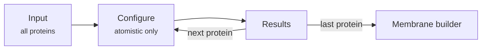
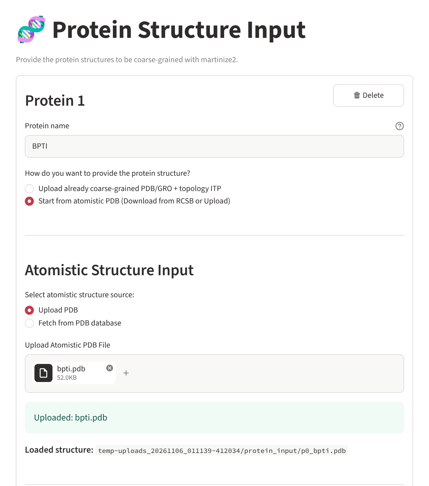
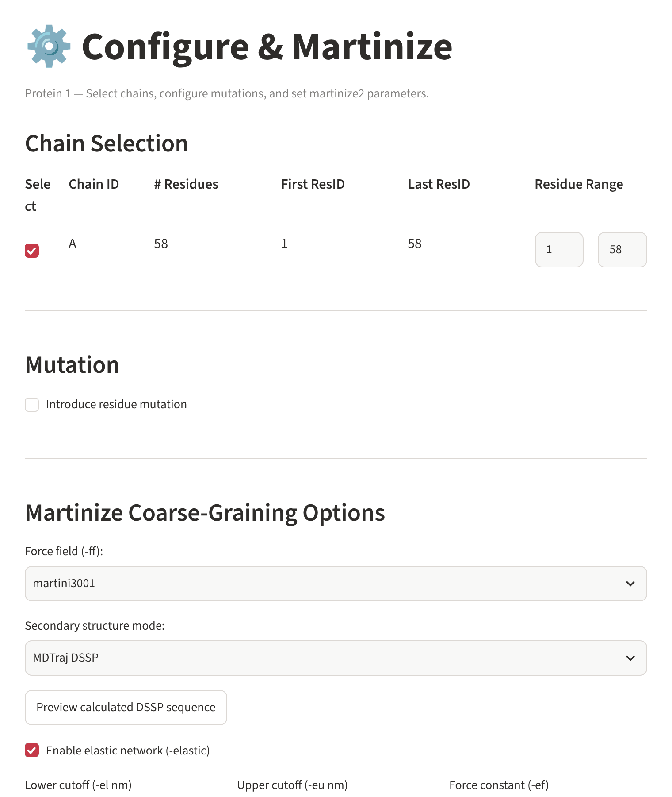
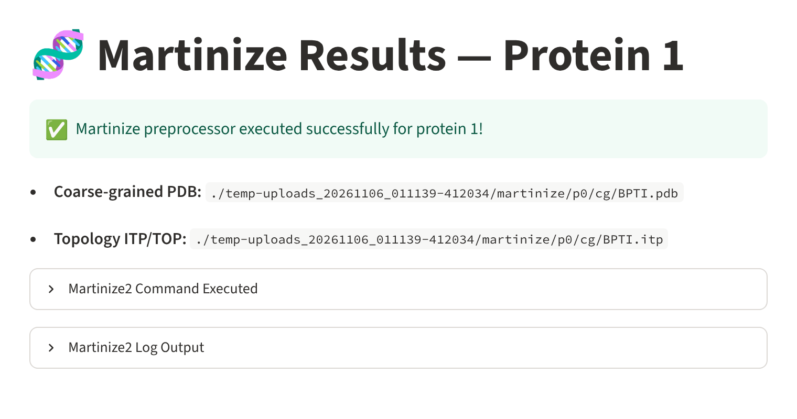

# Preparing proteins

The first step of the *Protein + Membrane* and *Protein only* workflows. Here you list the
proteins of your system and turn each one into a Martini coarse-grained model. When all are
ready, they are handed to the membrane builder.

The step has three pages, done for one protein after the other:



## 1. Input

{ .screenshot }

Each protein has its own panel. **➕ Add a protein** adds another one; **🗑 Delete** removes
it.

### Protein name

Every protein needs a **name** (for example `1UBQ`, `FGF2`, `GSDMD-NT`):

- its structure and topology are handed on as `<name>.pdb` and `<name>.itp`;
- the topology lists it under this name, both in the `.itp` file
  (`[ moleculetype ]` → `1UBQ 1`) and in `topol.top` (`[ molecules ]` → `1UBQ 1`);
- use letters, digits, `_` and `-` only (no spaces or dots), and a different name for each
  protein (upper/lower case does not count as different).

### Where the structure comes from

=== "Already coarse-grained"

    *Upload already coarse-grained PDB/GRO + topology ITP*

    - **CG structure** – `.pdb` or `.gro`.
    - **Protein topology** – the `.itp` file (it must contain a `[ moleculetype ]` section).
    - **Martini version of these files** – *Martini 2*, *Martini 3* or *unknown*. It is used
      to warn you when the protein and the membrane force field do not belong together.

    These proteins skip the configure page and go straight to the results page, where the
    files are checked and renamed to `<name>.pdb` / `<name>.itp`.

=== "Atomistic structure"

    *Start from atomistic PDB (Download from RCSB or Upload)*

    - **Upload PDB** – your own atomistic structure, or
    - **Fetch from PDB database** – type a four-character PDB code (e.g. `1UBQ`) and press
      **Fetch Structure**; it is downloaded from the RCSB PDB.
    - **Clean structure with MDAnalysis** – keeps only the protein (removes water, ligands,
      ions). Recommended.

    Loading another structure resets the chain and mutation choices of this protein.

Press **Next →**. All proteins are checked (name, files) and the errors listed, if any.

## 2. Configure (atomistic structures)

{ .screenshot }

### Chain selection

Each chain of the structure is listed with its number of residues and its first and last
residue number. Tick the chains to keep and, if needed, narrow the **residue range** of each
(for example to drop a disordered tail).

### Mutation

Tick **Introduce residue mutation** to replace one amino acid before coarse-graining: choose
the chain, optionally filter by amino-acid type, pick the residue and the new amino acid. The
mutation is made with PyMOL's mutagenesis tool, so PyMOL must be installed
(`conda install -c conda-forge pymol-open-source`).

### martinize2 options

| Option | Choices | Meaning |
|---|---|---|
| **Force field** (`-ff`) | `martini3001`, `martini3001-idp`, `martini22` | Martini 3 (also its variant for disordered proteins) or Martini 2.2. Must match the membrane force field. |
| **Secondary structure mode** | MDTraj DSSP, All coil, None, Custom/Precalculated | Where the secondary structure comes from. *MDTraj DSSP* calculates it from the structure (press **Preview calculated DSSP sequence** to see it); *Custom* lets you type one letter per residue (H helix, E strand, C coil …). |
| **Elastic network** (`-elastic`) | on/off, lower and upper cut-off (nm), force constant (kJ mol⁻¹ nm⁻²) | Springs between backbone beads that keep the fold; default 0.5–0.9 nm, 700. |
| **Position restraints** (`-p`) | none, backbone, all | Restraint blocks written into the `.itp`. |
| **Cysteine bridges** (`-cys`) | auto, detect, none | How disulfide bridges are found. |
| **Extra martinize2 options** | free text | Anything else martinize2 understands, separated by spaces. |

Press **🧬 Run Martinize Preprocessor**.

## 3. Results

{ .screenshot }

martinize2 runs (or the uploaded files are checked) and the outcome is shown: the paths of the
coarse-grained structure and topology, the exact martinize2 command and its output.

- **Next protein ➡️** – continues with the next protein.
- **Next: Membrane Builder ➡️** – after the last protein, hands all proteins on.
- On failure: **← Go back and fix** returns to the configure page; **🗑 Delete this protein**
  drops it and continues.

Coming back to this page later shows the stored result; the protein is only prepared again
when its input or settings changed.

!!! warning "Martini 2 and Martini 3 do not mix"
    A Martini 3 protein needs the Martini 3 membrane (`martini_v3`), a Martini 2.2 protein the
    Martini 2.2 membrane. The membrane and preview pages warn you when they differ, and the
    build needs an explicit confirmation.

## What is passed on

For each protein the membrane builder receives `<name>.pdb`, `<name>.itp` and its Martini
version. In the output they end up as

```text
user_inputs/1UBQ.pdb, user_inputs/1UBQ.itp     your protein, as prepared
toppar/1UBQ.itp                                 used by the topology ([ moleculetype ] 1UBQ 1)
systems/R0001/1UBQ.pdb                          the copy COBY reads for that system
```
