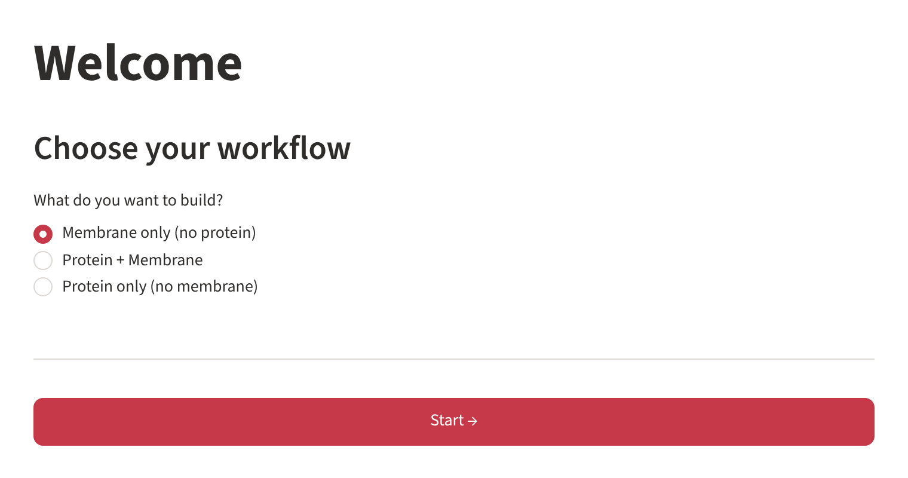
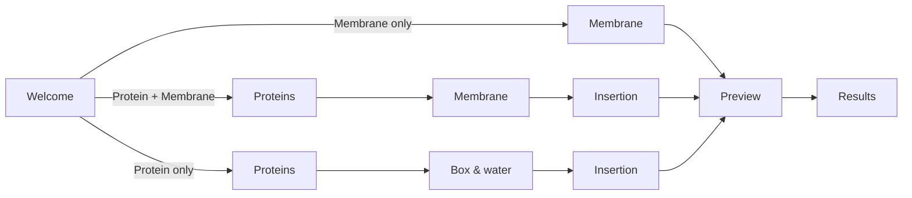

# The workflow

`omb gui` opens a step-by-step assistant (a *wizard*) in your browser. Every page has its
settings in the **sidebar** on the left and its main content on the right; **← Back** and
**Next →** move between the pages, and every value you entered is kept when you go back.

## Choose what to build

{ .screenshot }

| Workflow | Pages | Use it for |
|---|---|---|
| **Membrane only (no protein)** | Membrane → Preview → Results | lipid bilayers |
| **Protein + Membrane** | Proteins → Membrane → Insertion → Preview → Results | peripheral or transmembrane proteins with a membrane |
| **Protein only (no membrane)** | Proteins → Box & water → Insertion → Preview → Results | proteins in water |

Press **Start →** to begin. Once a workflow has started, the sidebar shows **↩ Change
workflow**, which returns to this page and starts over.



## The pages

1. [**Preparing proteins**](proteins.md) – name each protein and give its structure: upload
   coarse-grained files, or convert an atomistic structure with martinize2.
2. [**Building the membrane**](membrane.md) – force field, box, water and ions, number of
   systems, and the lipid composition (typed in or from a [template](templates.md)).
3. [**Inserting proteins**](protein-insertion.md) – position, height, rotation and copies of
   every protein, with a live system view.
4. [**Preview, build and results**](build-results.md) – check everything, build, download.

## What is kept, and where

- While you work, the values live in your browser session. Reloading the page in the
  browser starts a new session.
- Uploaded files are stored in a temporary folder `temp-uploads_<date>_<time>-<number>/` in the
  folder where you started `omb gui`; it is removed after the build.
- The build is written to `output/` and `downloads/` (see [Installation](../getting-started/installation.md#where-your-files-go)),
  together with a `config.json` that records every setting, so the same systems can be
  rebuilt with [`omb cli`](cli.md).

## Starting the app

```bash
omb gui                                   # default port 8501
omb gui --port 8502                       # another port (e.g. when 8501 is busy)
omb gui --server.headless true            # do not open a browser (e.g. on a remote machine)
omb gui --no-run                          # no "Run simulations" button (shared / public servers)
OMB_WORKDIR=/data/builds omb gui          # write output/ and downloads/ elsewhere
```

Any option that `omb` does not know is passed on to `streamlit run`.

!!! tip "Offering the app on a web server"
    Use `omb gui --no-run --server.headless true`. Visitors can build and download systems,
    but the [Run simulations](build-results.md#run-the-simulations) button is not shown, so
    nobody can start programs on the server.

!!! tip "Running on a remote machine"
    Start `omb gui --server.headless true` on the remote machine and forward the port:
    `ssh -L 8501:localhost:8501 user@remote`, then open <http://localhost:8501> locally.
